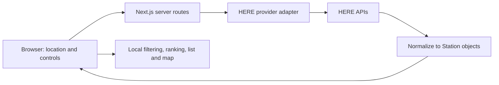

# PricePump

**Find your better fill-up.** Compare nearby US gas stations by price, distance, fuel grade, and brand—without creating an account.

Finding cheaper gas should not mean checking several apps or driving out of your way. PricePump brings station prices, distance, freshness, and directions into one mobile-first interface so drivers can choose their next stop.

**[Try PricePump live →](https://pricepump.vercel.app)**

**v1.0.1 is live.** Verified with automated browser tests at desktop/mobile sizes and hands-on desktop and physical-iPhone QA. [Testing and release details](docs/VERIFICATION.md)

## Screenshots


<p>
  
  
</p>

Screenshots use fictional demo data. The live app uses HERE; prices and availability vary by location.

## Key features

- **Search your area:** browser location or a city, ZIP, or address; 5, 10, and 15-mile radii.
- **Compare your options:** Regular, Mid-grade, and Premium; multiple preferred brands; Cheapest or Nearest sorting.
- **Understand the prices:** Low, Mid-range, High, and Very High percentile tiers, plus stale-price warnings and explicit missing-price states.
- **Explore List or Map:** station cards and Leaflet price markers, detailed station views, and Google/Apple Maps directions.
- **Explore progressively:** browse more stations with Show More, with clear notices when area coverage is partial.
- **Use it on the go:** responsive layouts, keyboard controls, accessible dialogs, and locally saved preferences.

## Tech stack

| Layer | Technology |
| --- | --- |
| Application | Next.js App Router, React, TypeScript |
| Interface | Tailwind CSS, shared CSS styles, Lucide icons |
| Station and location data | HERE Fuel Prices and Geocoding & Search |
| Map | Leaflet + OpenStreetMap |
| Validation and testing | Zod, Vitest, Playwright, axe accessibility checks |
| Hosting and preferences | Vercel; localStorage, with no database or authentication |

## Architecture



Server routes protect credentials and validate inputs. A provider adapter translates HERE responses into a consistent `Station` model, keeping the UI independent of HERE's raw format. The browser calculates straight-line distances and filters, sorts, and ranks the current results. Leaflet displays those stations on OpenStreetMap tiles.

The main code lives in `src/components` (UI), `src/lib/domain` (business rules), `src/lib/providers` (data adapters), and `src/lib/server` (request safeguards). See the [build guide](docs/BUILD_GUIDE.md) for implementation details and design tradeoffs.

## Security, privacy, and cost protection

- **Server-only credentials:** HERE requests run on the server. Real environment files are Git-ignored; only a placeholder `.env.example` is included.
- **Minimal location retention:** no database or saved location history. Device coordinates are rounded before searches; manual addresses are sent to HERE for lookup. localStorage saves only filter and sort preferences.
- **No shared live-data cache:** live HERE responses are not cached for reuse across requests or users.
- **Cost safeguards:** server validation, rate limiting, and deliberate pagination help control API usage. Rate limits are not a guaranteed spending cap.
- **Efficient browsing:** filters, sorting, and map interaction use the current results without triggering new HERE searches.
- **Clear data notices:** HERE terms/privacy links and source notices are available in live mode; OpenStreetMap attribution remains visible on the map.

HERE, the map-tile service, navigation apps, and the hosting platform process the requests needed for their services. See the [data-handling details](docs/BUILD_GUIDE.md#privacy) and [HERE notice review](docs/HERE_NOTICES.md).

## Run locally

Use **Node.js 24.x** and **pnpm 11.25.0**. In the repository directory:

```bash
pnpm install --frozen-lockfile
```

Copy `.env.example` to `.env.local` using your editor or file manager. The default `DATA_PROVIDER=demo` uses fictional Irvine-area data and requires no HERE key.

**Run `pnpm dev`, then open [http://localhost:3000](http://localhost:3000).** This address works only while the development server is running on your computer. The public app is [pricepump.vercel.app](https://pricepump.vercel.app).

For live local data, set `DATA_PROVIDER=here` and enter your own `HERE_API_KEY` privately in `.env.local`, then restart the server. Your HERE account must have Fuel Prices and Geocoding & Search access. Never commit the key or use a `NEXT_PUBLIC_` credential.

See [local setup and test commands](docs/LOCAL_DEVELOPMENT.md) for live-data configuration, automated checks, and troubleshooting. Tests use demo data or intercepted fixtures without a real HERE credential.

## Scope and limitations

V1 focuses on US stations, USD per US gallon, and straight-line distance. Prices can be stale or missing. Results load progressively, so a comparison is not a guarantee of the cheapest station in the entire area. Cash/credit differences and membership eligibility are not modeled. Apple Maps web may require choosing My Location; native behavior depends on the device and permissions.

## Future Improvements

- Cash vs. credit pricing and membership-aware comparisons
- Saved favorite stations
- Price history and price-change notifications, subject to provider licensing
- Route-aware recommendations and driving-distance comparisons
- User-submitted price corrections
- Native mobile application

## Project documentation

- [Architecture and implementation guide](docs/BUILD_GUIDE.md)
- [Local setup and Windows troubleshooting](docs/LOCAL_DEVELOPMENT.md)
- [Deployment and release checklist](docs/RELEASE_CHECKLIST.md)
- [Testing and release verification](docs/VERIFICATION.md)
- [HERE usage policy and notices](docs/HERE_NOTICES.md)
