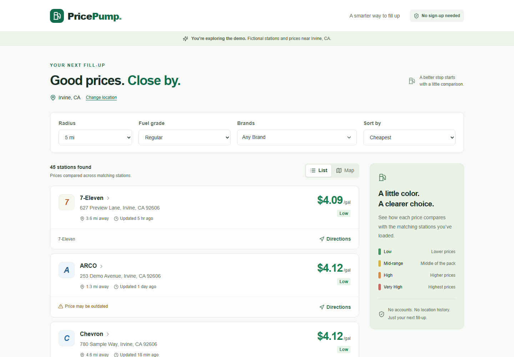
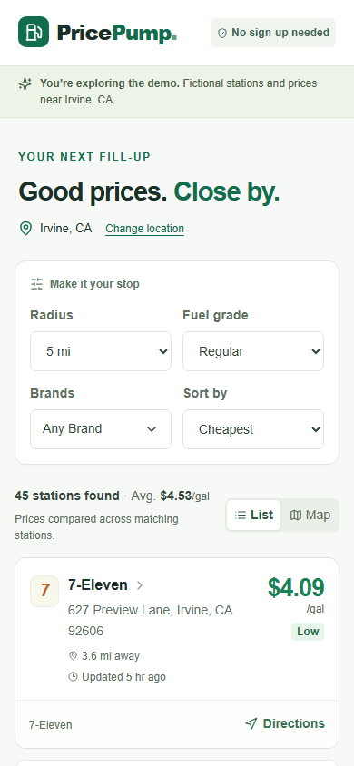
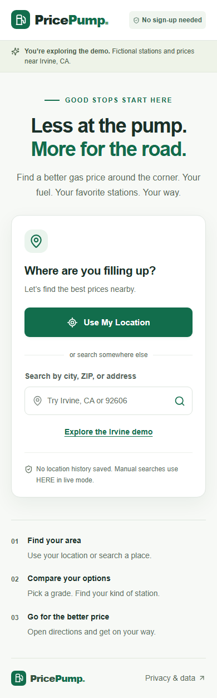
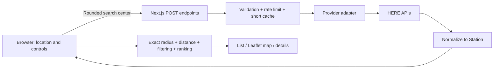

# Price Pump

**Find your better fill-up.** A mobile-first gas-price comparison app built with Next.js, TypeScript, HERE, and Leaflet.

Drivers often trade off price, distance, fuel grade, and preferred brands across several apps. Price Pump puts those decisions in one focused interface: choose an area, compare nearby stations, and open directions. No account or database required.

> **Current status:** The MVP supports explicit demo and live modes. Live HERE integration was checked for Irvine, Seattle, Houston, Chicago, New York, Honolulu, and Lusk, Wyoming on September 29, 2026. The October 7 follow-up passed 55 unit/server tests and 29 browser tests, including mobile layout and pagination beyond 150. The earlier geographic QA passed 6 opt-in live checks. See the verification report for scope and limitations. Screenshots show fictional demo data. No public deployment has been made.

## Screenshots

Desktop results:



<details>
<summary>Mobile results</summary>



</details>

<details>
<summary>Mobile first visit</summary>



</details>

The app screenshots show fictional demo data. The separate Apple Maps verification image in `docs/screenshots/apple-web-origin.png` uses a simulated public Irvine origin and a real station destination, not the user's location.

## MVP features

- One-click browser location or submitted city, ZIP, and address lookup; ambiguous matches offer a chooser.
- 5, 10, and 15-mile radii; Regular, Mid-grade, and Premium.
- Multi-select Chevron, ARCO, Shell, 76, Mobil, Costco, Sinclair, and 7-Eleven; Any Brand also includes independent/unlisted brands.
- Cheapest or Nearest sorting, with missing prices always last.
- Relative price tiers with color **and text**: Low, Average, High, Very High.
- Price-specific freshness warnings at more than 24 and 48 hours.
- Station details, all available fuel grades, and Google/Apple Maps directions.
- List and OpenStreetMap views with price markers and required attribution.
- Twenty visible cards initially; cached local expansion followed by deliberate provider pagination.
- Device-local preferences, keyboard controls, accessible dialogs, reduced-motion support, and responsive layouts.
- Clearly labeled demo data; live errors never fall back to fictitious prices.

## Technologies

| Area | Choice |
| --- | --- |
| Application | Next.js 16 App Router, React 19, TypeScript |
| Styling | Tailwind CSS 4, shared CSS design tokens, Lucide icons |
| Maps | Leaflet 1.9 and OpenStreetMap standard tiles |
| Data | HERE Fuel Prices v3; HERE Geocoding & Search v7 |
| Validation | Zod at API and provider boundaries |
| Testing | Vitest and Playwright/Chromium |
| Deployment | Vercel Node.js functions |
| Persistence | localStorage preferences only; no database/authentication |

Dependency versions are reproducible through `pnpm-lock.yaml`. Use Node.js 24 LTS and pnpm 11.25.0.

## Run locally

Install Node.js 24 and pnpm, then open a terminal in this repository:

```bash
npm install --global pnpm@11.25.0
pnpm install --frozen-lockfile
```

Copy the environment example:

```powershell
# Windows PowerShell
Copy-Item .env.example .env.local
```

```bash
# macOS / Linux
cp .env.example .env.local
```

```bash
pnpm dev
```

Open [http://127.0.0.1:3000](http://127.0.0.1:3000). Select **Explore the Irvine demo**, or manually search `Irvine`, `92606`, `Tustin`, or `Orange County` (the last offers multiple demo locations). The default 5-mile area has 45 exact-radius matches; increase to 10 miles to see the wider-area sample. Demo locations, addresses, and prices are fictional. A device outside the demo area will see no sample results and an Explore Irvine action.

To run the optimized production build locally:

```bash
pnpm build
pnpm start
```

## Environment variables and your HERE key

| Variable | Default | Purpose |
| --- | --- | --- |
| `DATA_PROVIDER` | `demo` | Set to `here` for live data; no automatic fallback. |
| `HERE_API_KEY` | Empty | Your server-side HERE API key. Required only in live mode. |

**You personally add the key in `.env.local`, next to `package.json`.** Do not put it in a component, README, screenshot, chat message, or GitHub file. Never rename it to `NEXT_PUBLIC_HERE_API_KEY`.

1. Sign in to the [HERE platform](https://platform.here.com/).
2. Register an application in Access Manager and create an API key using the [official setup instructions](https://docs.here.com/fuel-prices/docs/get-started).
3. Verify your account/app is entitled to **Fuel Prices** and **Geocoding & Search**, including US coverage. A valid general HERE key does not by itself prove Fuel Prices access.
4. In your ignored `.env.local`, set:

   ```dotenv
   DATA_PROVIDER=here
   HERE_API_KEY=replace_with_your_actual_key_locally
   ```

5. Restart the development server. Search a known US ZIP code. Confirm station prices, grade mappings, update timestamps, and coverage against your entitled HERE response.
6. If live calls fail, the app displays a safe error. Check service entitlement, credentials, billing, and coverage in HERE; the app deliberately does not print raw request URLs or provider responses into logs.

Only `demo` and `here` are supported modes; an unset mode selects demo. No key is required for builds or automated tests.

## Architecture and data flow



The map is a display layer, not a source of station prices. The UI never needs HERE's raw response format. `FuelProvider` and `LocationProvider` define the boundary for a future provider replacement; supporting a different provider means implementing that contract and normalization, not rebuilding the cards.

| Folder | Responsibility |
| --- | --- |
| `src/app` | Main page, metadata, styles, error boundary, and POST API routes |
| `src/components` | Location search, filters, brands, summary, cards, details, map, loading/errors |
| `src/lib/domain` | Provider-independent types, distances, sorting, ranking, freshness, preferences |
| `src/lib/providers` | HERE transport, normalization, provider interfaces, fictional demo fixtures |
| `src/lib/server` | Request validation, rate limiting, cache, error sanitization |
| `tests` | Business logic, server boundary, and browser regression tests |
| `docs` | Screenshots, verification notes, and beginner/interview guide |

Public application endpoints accept JSON and return `Cache-Control: no-store`:

| Endpoint | Input | Output |
| --- | --- | --- |
| `POST /api/stations` | Rounded `center: {lat,lng}`, `radius: 5\|10\|15`, `offset` | Normalized stations, `nextOffset`, `complete`, `fetchedAt` |
| `POST /api/geocode` | `query` (2–200 characters) | US location candidates |
| `POST /api/reverse` | Rounded `center` | Approximate location label and country |

Request bodies are capped at 2 KB. Coordinates, radii, and offsets are bounded; the client cannot select arbitrary upstream URLs or credentials. Unsupported US grades remain unavailable rather than being guessed. Station IDs are deduplicated across pages.

## HERE Fuel Prices usage

The adapter calls [`https://fuel.hereapi.com/v3/stations`](https://docs.here.com/fuel-prices/docs/resource-stations) server-side with a circular area, `returnAllStations=true`, 50-result pages, and distance ordering. Partial 10/15-mile searches add one farthest-first sample page inside the radius (at most two initial requests); ordinary nearest-first Show More fills the remaining coverage. Samples are labeled as partial, merged by station ID, and filtered to the exact radius. It requests all grades together so fuel selection is local. Official grade IDs **2, 3, and 4** map to Regular, Mid-grade, and Premium. Cash-only grades and ambiguous variants are excluded in V1.

The normalizer preserves valid positive USD prices from US stations. HERE `gal` is interpreted as US gallons **only for USA stations**; explicit `l` prices convert using 3.785411784 liters per US gallon. Unknown currencies/units, malformed values, and unavailable prices are excluded from pricing calculations. Stations remain visible without a usable price. Each fuel grade uses its own price `modified` timestamp, never a station-level or cache timestamp.

Manual search uses `/v1/geocode` with the US country filter. Browser location labels use `/v1/revgeocode` with the coarse center. Non-US reverse results show an unsupported-location message. Failure of the optional label lookup does not prevent otherwise valid US station results.

Coverage and price freshness depend on HERE. Showing unavailable prices does not imply HERE provides a complete census of every station.

## Ranking, sorting, and result completeness

For the selected grade, filter loaded stations by exact radius and brand. Exclude invalid prices, then sort valid prices ascending. Equal prices share the midpoint of their occupied positions. With zero-based tied positions `first` and `last`, the percentile is:

```text
percentile = (((first + last) / 2) + 0.5) / validPriceCount
```

| Percentile | Label | Color |
| --- | --- | --- |
| Under 25% | Low | Green |
| 25% to under 75% | Average | Yellow |
| 75% to under 90% | High | Orange |
| 90% and above | Very High | Red |

One valid price or an all-equal set is Average. Small sets need not contain every tier. Ties are never split merely to force exact group sizes. Categories are relative to **currently loaded, matching stations**, not a claim about regional market averages. The summary average uses valid selected-grade prices, including clearly flagged stale prices.

Prices more than 24 hours old are flagged as potentially outdated; more than 48 hours old get the stronger warning. Unknown or implausibly future timestamps say “Update time unavailable.” Price display rounds to cents; comparisons retain provider precision.

Cheapest sorts valid prices first, then distance and ID. Nearest sorts valid-price stations by straight-line distance, then ID. Missing prices come last in both modes. This is deliberately different from a pure distance sort.

Only 20 cards initially render. Show More reveals 20 additional locally available matches; only when those are exhausted does it fetch one more HERE page. Map view displays all loaded matches, so its Show More requests another page directly. New pages can change ordering, averages, and tiers. Until the provider is exhausted, the summary explicitly says the comparison uses loaded stations; it cannot guarantee the cheapest station across the entire area.

## Privacy

- No database, user accounts, analytics, or saved location history.
- Browser coordinates live only in component memory. The browser rounds coordinates to a 0.01-degree grid for station and reverse-label requests.
- The provider search radius adds 800 meters to cover grid displacement. The browser filters using the exact radius and calculates exact straight-line distances locally.
- Server cache keys contain only coarse search centers, radius, page, and provider. Cached station coordinates describe businesses, not user locations.
- A **manual address is sent through the server to HERE** to perform the requested lookup. These requests/responses are not application-cached or logged.
- localStorage key `price-pump.preferences.v1` contains only radius, fuel, selected brands, and sorting. Clearing browser site data resets preferences. List/Map choice is not saved.
- OpenStreetMap receives tile requests and associated network information when Map is opened. Moving a map can request map tiles, but never fuel-price searches.
- Google/Apple Maps receive only the chosen destination link when opened, and can request the user's starting location independently.
- HERE and hosting providers may maintain operational logs under their own policies. The app's safeguards do not constitute a promise about third-party retention.

## API cost protection

- Credentials and all HERE calls stay in server-only modules.
- Identical coarse-area/page requests use a **5-minute**, bounded, process-local memory cache. Concurrent identical requests share one upstream call. Failures are not cached.
- Changing brand, grade, sorting, list/map, opening details, and panning the map do not call HERE. A smaller radius reuses already retrieved coverage; increasing beyond it is an explicit search.
- Manual lookup runs on form submission, never on every keystroke. No polling, scheduled refresh, or automatic provider retry loop.
- Per-client API calls are limited to **30 per minute**. Temporary salted hashes identify clients; raw IPs are not retained in the limiter. Locally, requests share one bucket. In Vercel, the platform-provided forwarding header identifies the client.
- Memory caches/counters reset on process restart and are not shared across serverless instances. They reduce accidental load, but **do not guarantee a global spending cap**. The bounded pagination input is not authentication, and a determined distributed attacker can still consume requests.
- Before publicly exposing live credentials, add the Vercel Firewall rule below and configure available usage alerts/limits in HERE. A shared quota service would strengthen a future version but is intentionally outside the no-database V1.

## Test and verify

For local preview restarts and persistent manual testing, see [Keeping the local preview available](docs/LOCAL_DEVELOPMENT.md). `pnpm dev` uses Webpack on port 3000; optional background start/status/stop commands are documented there.

```bash
pnpm typecheck
pnpm test
pnpm build
pnpm exec playwright install chromium
pnpm test:e2e
```

The browser suite starts the production build in demo mode on `127.0.0.1:3100`, with an empty HERE key. It never automatically reuses the live development server on port 3000. Build first. A preflight check rejects a live-mode test server before searches. Screenshots are generated in `docs/screenshots`. CI runs checks on pull requests and pushes. Controlled fixtures test failures without spending HERE credits; actual demo endpoints are also tested.

On Windows environments where Playwright hangs during child-server shutdown, start a separate terminal with `$env:DATA_PROVIDER='demo'`, `$env:HERE_API_KEY=''`, and `pnpm exec next start --hostname 127.0.0.1 --port 3100`. In the test terminal set `$env:PRICE_PUMP_EXTERNAL_DEMO_SERVER='1'` before `pnpm test:e2e`. Stop the dedicated demo server afterward. This workaround was used successfully for the final local run; CI uses automatic server management.

Live coverage checks are deliberately skipped by default. With a live server on port 3000, opt in using `$env:PRICE_PUMP_LIVE_QA='1'` and `pnpm exec vitest run tests/live-qa.test.ts --configLoader runner`. This makes up to 21 local API requests (fewer paid calls when cache entries exist). Remove that environment variable afterward. Live results can change; this suite is not part of CI.

See [verification notes](docs/VERIFICATION.md) for the checks actually run and their limitations.

## Deploy to Vercel

Preserve the release locally, then push to an initially **private** personal GitHub repository named `price-pump`. Keep the repository root at this app's `package.json`, not the surrounding workspace. Require green GitHub Actions before importing into Vercel. See the [release checklist](docs/RELEASE_CHECKLIST.md) for the manual gates.

Use Next.js, production branch `main`, root `.`, Node.js **24.x**, install command `corepack pnpm install --frozen-lockfile`, build command `pnpm build`, and the default Next.js output. The build script explicitly uses Webpack; type checking generates Next's types first. Generated `next-env.d.ts` is intentionally ignored. Do not use static export.

| Variable | Initial Production | Live Production | Preview |
| --- | --- | --- | --- |
| `DATA_PROVIDER` | `demo` | `here` | `demo` |
| `HERE_API_KEY` | Absent | Enter privately in Vercel | Absent |
| `ENABLE_EXPERIMENTAL_COREPACK` | `1` | `1` | `1` |
| `NEXT_TELEMETRY_DISABLED` | `1` | `1` | `1` |

Corepack selects the pinned pnpm **11.25.0**. Confirm Node and pnpm versions in the build log. Do not upload `.env.local`, provide HERE secrets to GitHub Actions/Preview, or copy local QA/development variables into Vercel. No other application credentials are required.

**Manual account steps:** sign in to GitHub and Vercel, complete MFA, create the empty private repository, and authorize Vercel for only that repository. Review Hobby's personal/non-commercial terms; do not enable a paid upgrade unintentionally. Deploy in demo mode first.

Before enabling live data, publish a Vercel Firewall rule matching paths beginning `/api/`: Rate Limit, Fixed Window, **30 requests per 60 seconds per IP**, **Default (429)** action. Save, Review Changes, Publish. Verify enforcement and firewall events in demo mode without spending HERE requests. Counters are regional, not a global spending ceiling. Check your HERE account's public-display terms, attribution requirements, usage alerts, and available limits.

**Manual key entry:** in Vercel Project Settings → Environment Variables, enter the real `HERE_API_KEY` for **Production only**, change `DATA_PROVIDER` to `here`, then redeploy. Never paste the key into source or chat. Keep Standard Protection for non-production URLs and verify the production domain opens without login.

Verify the deployed HTTPS site and complete physical-iPhone testing before making GitHub public. Record deployment URL/ID, source SHA, and date. Update this README with the real URL and verified status only after those checks pass. If live operation fails or usage spikes, restore the known demo deployment or set Production `DATA_PROVIDER=demo` and redeploy.

References: [Vercel builds/Corepack](https://vercel.com/docs/builds/configure-a-build), [environment variables](https://vercel.com/docs/environment-variables), [rate limiting](https://vercel.com/docs/vercel-firewall/vercel-waf/rate-limiting), [deployment protection](https://vercel.com/docs/deployment-protection).

## Production readiness and MVP limits

Implemented and locally verified: buildable responsive UI, normalized provider boundary, secret separation, input validation, local preferences, business rules, controlled pagination, basic abuse safeguards, and automated regression tests.

Still MVP-level: process-local cache/rate limit, progressive rather than exhaustive cheapest-station search, basic brand aliases, straight-line distance, public OpenStreetMap tiles without an SLA, no operational monitoring dashboard, and no guarantee of provider completeness or current pump prices. Native iOS/Safari/Android and hosted HTTPS smoke tests remain outstanding. Successful checks in seven areas do not prove nationwide coverage. At higher map traffic, select a suitable OSM-compatible tile host under the [OpenStreetMap tile usage policy](https://operations.osmfoundation.org/policies/tiles/); do not bulk-prefetch tiles.

The cash/credit distinction is deliberately deferred: the app does not assert that the displayed standard price is the price for a particular payment method.

## Future Improvements

- Cash vs. credit pricing
- Saved favorite stations
- Price history
- Price-change notifications
- Route-aware gas recommendations
- Driving-distance instead of straight-line distance
- User-submitted price corrections
- Native mobile application

## Learning and interview preparation

Read the [beginner-friendly build guide](docs/BUILD_GUIDE.md) for the data flow, key technical decisions, product tradeoffs, and honest interview talking points about an AI-assisted implementation.
