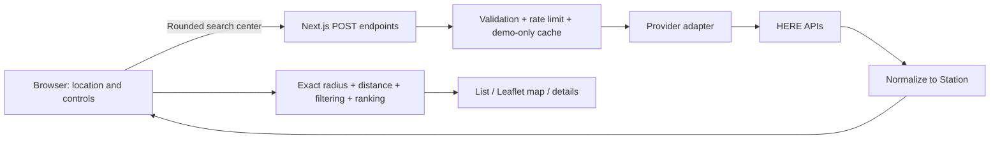

# Understanding Price Pump

## What happens when you search

1. You press **Use My Location**. The browser asks permission and returns coordinates. Alternatively, you submit text and HERE translates it into coordinates.
2. The browser keeps the precise search point in memory, rounds a copy, and sends that approximate point to your own Next.js server endpoint.
3. The server validates the request, checks its rate limiter, then calls HERE using the private environment key. Live requests never share responses; only demo mode uses a five-minute cache.
4. The HERE adapter translates raw data into Price Pump's `Station` type. Think of it as a translator: every component receives the same familiar vocabulary even if the provider changes later.
5. The browser computes straight-line distances from the precise point, excludes stations outside your chosen radius, filters brands, ranks prices, and renders cards or map pins.

Manual address lookup is the exception to “precise coordinates stay in the browser”: the server transiently processes the entered address and HERE's precise geocoding response to fulfill that lookup. Neither is saved by application code.

## Why there is a server without a database

The server's job is to protect the API key, validate requests, and reduce repeated paid calls. It does not need to remember users. A database stores durable records; this product doesn't need durable records for V1. Short-lived memory caches are used only for fictional demo data. Live results remain only in the active screen, not a reusable search cache.

The absence of a database is a scope decision, not an assertion that databases are bad. Accounts, notifications, and price histories would justify durable storage later.

## The files to learn first

| File or folder | What to look for |
| --- | --- |
| `src/components/PricePumpApp.tsx` | Search lifecycle, selected filters, visible result batches, and stale-request cancellation |
| `src/components/LocationSearch.tsx` | Permission flow and submitted address lookup |
| `src/lib/domain/types.ts` | The internal data contract; UI components depend on this, not HERE JSON |
| `src/lib/providers/here.ts` | Private network requests to HERE |
| `src/lib/providers/normalize.ts` | Fuel IDs, units, brands, missing data, and timestamps |
| `src/lib/domain/stations.ts` | Distances, sorting, filtering and price tiers |
| `src/lib/server` | Cache, rate limiter, request validation, and safe errors |
| `src/components/StationMap.tsx` | Leaflet display, safe popup content, and map lifecycle |
| `tests` | Examples that specify expected behavior and protect changes |

## Price rankings in plain English

“Cheap” depends on the area. A $4.50 price might be low in one city and high in another, so hard-coding dollar thresholds would mislead people.

Price Pump compares each valid selected-grade price with the other currently loaded matching prices. Roughly the bottom quarter are Low, the middle half Mid-range, the next 15% High, and the top 10% Very High. Equal prices receive the same classification. If every price is equal, they are all Mid-range. Missing prices receive no tier and come last.

For example, with 100 distinct prices, 25 are Low, 50 Mid-range, 15 High, and 10 Very High. With two identical prices, both are Mid-range. Ties and very small groups make exact percentages impossible, which is why the algorithm prioritizes consistent treatment rather than perfect quotas.

Loading more stations can change a station's tier without its price changing. The comparison set changed. The interface explicitly explains this limitation.

## How costs are controlled

Demo caching means “we just answered this nearby search—reuse it briefly.” Live HERE mode deliberately disables this optimization. Rate limiting means “this caller is asking too often—wait a minute.” They solve different problems.

Fuel and brand filters, sorting, details, and map/list changes use data already in the browser. The first 50-provider-result page can serve several 20-card display batches. Partial 10/15-mile searches also request one outer-area sample page, so the map visibly covers the wider area without downloading every nearby station. This is capped at two initial requests, both rate-limited; caching applies only to demo data. Further nearest-first pages require an explicit Show More click. No polling or map-pan fuel requests occur.

The memory limiter isn't sufficient for a large distributed deployment because different server instances have different memory. The Vercel Firewall rule adds platform-level protection. Even that is not an absolute provider spending cap; distributed abuse and provider terms still matter. These are honest MVP limits to discuss in an interview.

## Location, map, and localStorage

- Browser location works on localhost and HTTPS, after permission. Denial isn't a dead end: manual search remains available.
- A 0.01-degree area grid avoids sending the exact device coordinates and improves demo-cache reuse. Adding 800 meters to the provider radius prevents losing stations near the rounding boundary. Exact filtering happens locally.
- Leaflet places pins on OpenStreetMap tiles. It doesn't discover station prices. Moving the map requests map images as needed, not HERE fuel data.
- Navigation links carry a destination only. The chosen maps app handles routes and the starting point.
- localStorage remembers only radius, grade, brands, and sorting on that device. It is not an account, cloud sync, or location history. A blocked storage API doesn't break searching.

## Run and deploy

Use Node 24.x and pnpm 11.25.0. `pnpm typecheck` generates Next.js types before checking TypeScript; `pnpm build` explicitly uses Webpack. For local demo use: `pnpm install --frozen-lockfile`, copy `.env.example` to `.env.local`, then `pnpm dev`. For a production build: `pnpm build` and `pnpm start`.

To enable HERE, put the key in the ignored `.env.local`, set `DATA_PROVIDER=here`, and restart. To deploy, follow the README: start with demo mode, enable Corepack for pinned pnpm, publish and verify the firewall rule, then privately enter the HERE key for Production only. Preview builds stay in demo mode without a key. Vercel needs a redeployment after environment changes. See the README for exact steps and the firewall configuration.

## Interview talking points

Describe what you actually did and understand; do not claim unverified production scale or independent authorship of generated code.

An honest opening:

> I defined the product requirements and used an AI coding assistant to implement Price Pump. I learned to structure the provider boundary, compare prices fairly, protect credentials, and test edge cases. I can explain the architecture and the tradeoffs we chose.

Useful questions to prepare for:

- **Why an adapter?** To keep HERE-specific response details out of the UI and make replacement providers manageable.
- **Why no database?** V1 has no durable user records; it needs transient search data and device preferences only.
- **Why not just sort by price?** Missing data, ties, stale timestamps, selected grades, and incomplete provider pagination require explicit rules.
- **Why are prices not always current?** Provider timestamps describe upstream observations. The app makes uncertainty visible instead of hiding old prices.
- **What was a concrete bug caught during testing?** Next.js's internal hostname differed from the browser-facing host, so an origin check initially rejected valid local requests. Comparing Origin with the HTTP Host fixed it; a regression test protects that boundary.
- **What else did testing improve?** Enlarged text exposed a mobile header overflow; the layout now wraps and reflows at 200% text size.
- **What would you improve before scale?** Shared abuse controls, usage monitoring, live provider validation, broader device QA, and a suitable map-tile service.
- **What product tradeoff did you make?** Progressive loading reduces paid calls, but Cheapest ranks the loaded subset until the search is complete. The summary says this explicitly.

Avoid claiming live data verification, actual savings, adoption, production uptime, or recruiter/customer outcomes until you have measured them.


## Technical reference

## Architecture and data flow



The map is a display layer, not a source of station prices. The UI never needs HERE's raw response format. `FuelProvider` and `LocationProvider` define the boundary for a future provider replacement; supporting a different provider means implementing that contract and normalization, not rebuilding the cards.

| Folder | Responsibility |
| --- | --- |
| `src/app` | Main page, metadata, styles, error boundary, and POST API routes |
| `src/components` | Location search, filters, brands, summary, cards, details, map, loading/errors |
| `src/lib/domain` | Provider-independent types, distances, sorting, ranking, freshness, preferences |
| `src/lib/providers` | HERE transport, normalization, provider interfaces, fictional demo fixtures |
| `src/lib/server` | Request validation, rate limiting, cache, error sanitization |
| `tests` | Business logic, server boundary, and browser regression tests |
| `docs` | Screenshots, verification notes, and beginner/interview guide |

Public application endpoints accept JSON and return `Cache-Control: no-store`:

| Endpoint | Input | Output |
| --- | --- | --- |
| `POST /api/stations` | Rounded `center: {lat,lng}`, `radius: 5\|10\|15`, `offset` | Normalized stations, `nextOffset`, `complete`, `fetchedAt` |
| `POST /api/geocode` | `query` (2–200 characters) | US location candidates |
| `POST /api/reverse` | Rounded `center` | Approximate location label and country |

Request bodies are capped at 2 KB. Coordinates, radii, and offsets are bounded; the client cannot select arbitrary upstream URLs or credentials. Unsupported US grades remain unavailable rather than being guessed. Station IDs are deduplicated across pages.

## HERE Fuel Prices usage

The adapter calls [`https://fuel.hereapi.com/v3/stations`](https://docs.here.com/fuel-prices/docs/resource-stations) server-side with a circular area, `returnAllStations=true`, 50-result pages, and distance ordering. Partial 10/15-mile searches add one farthest-first sample page inside the radius (at most two initial requests); ordinary nearest-first Show More fills the remaining coverage. Samples are labeled as partial, merged by station ID, and filtered to the exact radius. It requests all grades together so fuel selection is local. Official grade IDs **2, 3, and 4** map to Regular, Mid-grade, and Premium. Cash-only grades and ambiguous variants are excluded in V1.

The normalizer preserves valid positive USD prices from US stations. HERE `gal` is interpreted as US gallons **only for USA stations**; explicit `l` prices convert using 3.785411784 liters per US gallon. Unknown currencies/units, malformed values, and unavailable prices are excluded from pricing calculations. Stations remain visible without a usable price. Each fuel grade uses its own price `modified` timestamp, never a station-level or cache timestamp.

Manual search uses `/v1/geocode` with the US country filter. Browser location labels use `/v1/revgeocode` with the coarse center. Non-US reverse results show an unsupported-location message. Failure of the optional label lookup does not prevent otherwise valid US station results.

Coverage and price freshness depend on HERE. Showing unavailable prices does not imply HERE provides a complete census of every station.

## Ranking, sorting, and result completeness

For the selected grade, filter loaded stations by exact radius and brand. Exclude invalid prices, then sort valid prices ascending. Equal prices share the midpoint of their occupied positions. With zero-based tied positions `first` and `last`, the percentile is:

```text
percentile = (((first + last) / 2) + 0.5) / validPriceCount
```

| Percentile | Label | Color |
| --- | --- | --- |
| Under 25% | Low | Green |
| 25% to under 75% | Mid-range | Yellow |
| 75% to under 90% | High | Orange |
| 90% and above | Very High | Red |

One valid price or an all-equal set is Mid-range. Small sets need not contain every tier. Ties are never split merely to force exact group sizes. Categories are relative to **currently loaded, matching stations**, not a regional market statistic.

Prices more than 24 hours old are flagged as potentially outdated; more than 48 hours old get the stronger warning. Unknown or implausibly future timestamps say “Update time unavailable.” Price display rounds to cents; comparisons retain provider precision.

Cheapest sorts valid prices first, then distance and ID. Nearest sorts valid-price stations by straight-line distance, then ID. Missing prices come last in both modes. This is deliberately different from a pure distance sort.

Only 20 cards initially render. Show More reveals 20 additional locally available matches; only when those are exhausted does it fetch one more HERE page. Map view displays all loaded matches, so its Show More requests another page directly. New pages can change ordering and tiers. Until the provider is exhausted, the summary explicitly says the comparison uses loaded stations; it cannot guarantee the cheapest station across the entire area.

## Privacy

- No database, user accounts, analytics, or saved location history.
- Browser coordinates live only in component memory. The browser rounds coordinates to a 0.01-degree grid for station and reverse-label requests.
- The provider search radius adds 800 meters to cover grid displacement. The browser filters using the exact radius and calculates exact straight-line distances locally.
- Live HERE results are not cached or shared between requests. Only fictional demo searches use the server cache. The browser retains live results only for the current search display and does not save them in localStorage.
- A **manual address is sent through the server to HERE** to perform the requested lookup. These requests/responses are not application-cached or logged.
- localStorage key `price-pump.preferences.v1` contains only radius, fuel, selected brands, and sorting. Clearing browser site data resets preferences. List/Map choice is not saved.
- OpenStreetMap receives tile requests and associated network information when Map is opened. Moving a map can request map tiles, but never fuel-price searches.
- Google/Apple Maps receive only the chosen destination link when opened, and can request the user's starting location independently.
- HERE and hosting providers may maintain operational logs under their own policies. The app's safeguards do not constitute a promise about third-party retention.

## API cost protection

- Credentials and all HERE calls stay in server-only modules.
- **Live HERE mode:** every API request independently calls HERE. No response cache or concurrent-request sharing is used, regardless of upstream cache headers. Fetches and API responses use `no-store`. Explicit radius changes and repeated searches fetch again; prior searches are not retained in the browser search cache.
- **Demo mode:** identical coarse-area/page requests retain the existing **5-minute** bounded memory cache and concurrent-request sharing. Failures are not cached.
- Sorting, grades, brands, details, and List/Map still operate on the current screen’s loaded results. Show More reveals loaded cards before requesting another page. Results are discarded when a new live search starts.
- Changing brand, grade, sorting, list/map, opening details, and panning the map do not call HERE. Every explicit live radius change starts a fresh search. Demo mode can reuse retrieved coverage.
- Manual lookup runs on form submission, never on every keystroke. No polling, scheduled refresh, or automatic provider retry loop.
- The production Vercel firewall limits `/api/` to **15 requests per 60 seconds per IP** (owner confirmed publication October 10, 2026). The separate process-local app limiter remains **30 per minute**. Temporary salted hashes identify clients; raw IPs are not retained in the limiter. Locally, requests share one bucket. In Vercel, the platform-provided forwarding header identifies the client.
- Demo caches and rate-limit counters reset on process restart and are not shared across serverless instances. They reduce accidental load, but **do not guarantee a global spending cap**. The bounded pagination input is not authentication, and a determined distributed attacker can still consume requests.
- Before publicly exposing live credentials, add the Vercel Firewall rule below and configure available usage alerts/limits in HERE. A shared quota service would strengthen a future version but is intentionally outside the no-database V1.
